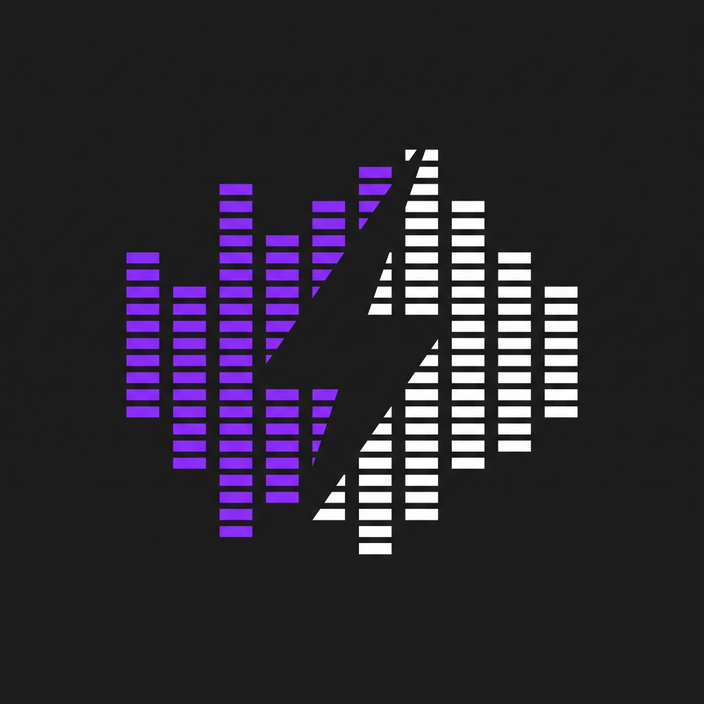

# QuickSFX ⚡

<p align="center">
  
</p>

<p align="center">
  <strong>Fast, unified sound effects search and timeline integration for DaVinci Resolve.</strong>
</p>

<p align="center">
  
  
  
  
</p>

<p align="center">
  <a href="#-english"></a>
  &nbsp;&nbsp;&nbsp;&nbsp;
  <a href="#-türkçe"></a>
</p>

---

<a name="-english"></a>
# 🇬🇧 English

**QuickSFX** is a native **Workflow Integration plugin** for **DaVinci Resolve Studio**. It lets video editors browse, search, preview, and instantly drop thousands of free sound effects from multiple top platforms directly into their project timeline without ever leaving DaVinci Resolve.

---

## ✨ Features

- **🌐 Multi-Source Search:** Simultaneously queries **Pixabay**, **Mixkit**, **MyInstants**, and **Freesound** with instant filtering.
- **⚡ Instant Timeline Insertion:**
  - **At Playhead:** Places the audio clip directly at your current timeline cursor.
  - **At Timeline End:** Appends to the end of the SFX audio track.
  - **Media Pool Only:** Imports directly into your project's `SFX Finder` bin without touching the timeline.
- **🖐 Native Drag & Drop:** Drag any sound effect row directly onto any track or location on your timeline.
- **🎧 Responsive Audio Player Deck:**
  - Interactive scrubbing bar to jump to any part of the audio.
  - 2-second quick jump (`←` / `→`) and continuous audio loop toggle.
  - Smooth volume slider with mouse-wheel scroll adjustment and mute toggle.
- **🏷️ Quick Preset Tags:** Pre-configured filters for Whoosh, Impact, Riser, Glitch, Transition, Meme (Vine boom), Foley, Ambience, and more (supports horizontal mouse-wheel scrolling).
- **🌍 Bilingual & Customizable:**
  - Built-in **English** 🇬🇧 and **Türkçe** 🇹🇷 language options.
  - **Dark**, **Light**, and **System** appearance themes.
  - Always-on-top window pin toggle.
- **🔄 Auto-Update Notification:** Automatically alerts you inside DaVinci Resolve whenever a new version is published on GitHub.
- **⚡ Zero Background RAM Footprint:** Closes instantly with 0ms delay and completely frees up memory when closed.

---

## 📋 Requirements

1. **DaVinci Resolve Studio 18 or later**  
   *(Note: Workflow Integrations is a native feature of DaVinci Resolve Studio).*
2. **Windows 10 / 11 (64-bit)**
3. **Python 3.10+** *(Only required if building from source or using the manual Python installer; NOT needed if using `QuickSFX-Setup.exe`).*

---

## 🚀 Installation

### Option 1: Standalone Windows Installer (Easiest — Recommended ⭐)

> 💡 **No Python installation, terminal commands, or dependencies required!**

1. Go to the [Releases](https://github.com/sertay1/QuickSFX/releases) page and download **`QuickSFX-Setup.exe`**.
2. Double-click **`QuickSFX-Setup.exe`** and click **⚡ Install QuickSFX**.
3. Open **DaVinci Resolve Studio** and navigate to:  
   👉 **Workspace → Workflow Integrations → QuickSFX**

---

### Option 2: 1-Click Batch Setup (From Source)

1. Download or clone this repository:
   ```bash
   git clone https://github.com/sertay1/QuickSFX.git
   ```
2. Double-click **`install.bat`** (or right-click → **Run as administrator**).
3. The script automatically verifies Python, installs dependencies, and deploys the plugin.
4. Launch DaVinci Resolve Studio → **Workspace → Workflow Integrations → QuickSFX**.

---

### Option 3: Manual Python Setup

1. Install dependencies:
   ```bash
   pip install -r requirements.txt
   ```
2. Run the deployment script:
   ```bash
   python install.py
   ```
3. Restart DaVinci Resolve Studio.

---

## ⌨️ Keyboard Shortcuts

| Shortcut | Action |
| :--- | :--- |
| `/` | Focus search bar |
| `Space` | Play / Pause audio preview |
| `Enter` | Insert selected sound to timeline |
| `←` / `→` | Rewind / Fast forward preview by 2 seconds |
| `↑` / `↓` | Navigate through sound results list |
| `Esc` | Clear search or close modals |

---

## 🗑️ Uninstallation

To remove QuickSFX from DaVinci Resolve:
- Double-click **`uninstall.bat`**  
*(or delete `C:\ProgramData\Blackmagic Design\DaVinci Resolve\Support\Workflow Integration Plugins\com.serta.sfxfinder`)*

---
---

<a name="-türkçe"></a>
# 🇹🇷 Türkçe

**QuickSFX**, **DaVinci Resolve Studio** için geliştirilmiş yerel bir **Workflow Integration (İş Akışı Entegrasyonu)** eklentisidir. Video editörlerinin DaVinci Resolve'dan hiç çıkmadan binlerce ücretsiz ses efektini aramasını, önizlemesini ve tek tıkla timeline'a eklemesini sağlar.

---

## ✨ Özellikler

- **🌐 Tek Yerden Çoklu Platform Araması:** **Pixabay**, **Mixkit**, **MyInstants** ve **Freesound** platformlarını eşzamanlı tarar ve anlık filtreleme sunar.
- **⚡ Anında Timeline'a Ekleme:**
  - **İmlece (Playhead):** Sesi doğrudan zaman çizginizdeki imlecin bulunduğu kareye yerleştirir.
  - **Timeline Sonuna:** SFX ses parçanızın en sonuna ekler.
  - **Sadece Media Pool:** Timeline'ı bozmadan projenizin havuzuna aktarır.
- **🖐 Doğrudan Sürükle & Bırak:** Beğendiğiniz sesi tutup doğrudan DaVinci Resolve timeline'ındaki istediğiniz kanala sürükleyebilirsiniz.
- **🎧 Gelişmiş Önizleme Oynatıcısı:**
  - Seste istediğiniz saniyeye tıklayarak atlayabileceğiniz interaktif scrubber çubuğu.
  - 2 saniye hızlı sarma tuşları (`←` / `→`) ve kesintisiz döngü (loop) modu.
  - Fare tekerleğiyle ayarlanabilen ses seviyesi ve tek tıkla sessize alma.
- **🏷️ Hızlı Kategori Etiketleri:** Whoosh, Vuruş/Impact, Riser, Glitch, Meme (Vine boom), UI Pop, Doğa/Ambiyans ve Adım gibi kategoriler arasında fare tekerleğiyle kaydırarak hızlı geçiş.
- **🌍 Çift Dil & Kişiselleştirme:**
  - Dahili **Türkçe** 🇹🇷 ve **İngilizce** 🇬🇧 dil seçeneği.
  - **Koyu (Dark)**, **Aydınlık (Light)** ve **Sistem** temaları.
  - Pencereyi her zaman üstte tutma (Pin) özelliği.
- **🔄 Otomatik Güncelleme Bildirimi:** GitHub'da yeni bir sürüm çıktığında DaVinci Resolve içinde parlayan bir rozetle size anında haber verir.
- **⚡ Sıfır RAM Yükü:** Paneli kapattığınız anda 0 ms'de kapanır ve arka planda çalışan hiçbir işlemci/RAM yükü bırakmaz.

---

## 📋 Sistem Gereksinimleri

1. **DaVinci Resolve Studio 18 veya daha yenisi**  
   *(Not: Workflow Integrations özelliği DaVinci Resolve Studio sürümüne aittir).*
2. **Windows 10 / 11 (64-bit)**
3. **Python 3.10+** *(Sadece kaynak koddan veya manuel kurmak isteyenler için gereklidir; `QuickSFX-Setup.exe` kullananlar için **gerekmez**).*

---

## 🚀 Kurulum Seçenekleri

### 1. Seçenek: Bağımsız Windows Kurulum Sihirbazı (En Kolay — Tavsiye Edilen ⭐)

> 💡 **Bilgisayarınızda Python, komut satırı veya harici hiçbir şey kurulu olmasına gerek yoktur!**

1. [Releases](https://github.com/sertay1/QuickSFX/releases) sayfasından en güncel **`QuickSFX-Setup.exe`** dosyasını indirin.
2. **`QuickSFX-Setup.exe`** dosyasına çift tıklayın ve **⚡ Install QuickSFX** butonuna basın.
3. **DaVinci Resolve Studio**'yu açıp menüden eklentinizi başlatın:  
   👉 **Workspace → Workflow Integrations → QuickSFX**

---

### 2. Seçenek: Tek Tıkla Batch Kurulumu (Kaynak Koddan)

1. Bu depoyu indirin veya klonlayın:
   ```bash
   git clone https://github.com/sertay1/QuickSFX.git
   ```
2. **`install.bat`** dosyasına çift tıklayın (veya sağ tıklayıp **Yönetici olarak çalıştır** deyin).
3. Betik otomatik olarak Python ortamınızı denetler, kütüphaneleri kurar ve eklentiyi DaVinci Resolve'a yerleştirir.
4. DaVinci Resolve Studio → **Workspace → Workflow Integrations → QuickSFX**.

---

### 3. Seçenek: Manuel Python Kurulumu

1. Bağımlılıkları yükleyin:
   ```bash
   pip install -r requirements.txt
   ```
2. Kurulum betiğini çalıştırın:
   ```bash
   python install.py
   ```
3. DaVinci Resolve Studio'yu yeniden başlatın.

---

## ⌨️ Klavye Kısayolları

| Kısayol | İşlev |
| :--- | :--- |
| `/` | Arama kutusuna odaklan |
| `Space` | Önizlemeyi Başlat / Durdur |
| `Enter` | Seçili sesi timeline'a ekle |
| `←` / `→` | Seste 2 sn geri / ileri sar |
| `↑` / `↓` | Listede yukarı / aşağı ses seç |
| `Esc` | Aramayı veya pencereleri kapat |

---

## 🗑️ Kaldırma (Uninstall)

QuickSFX'i DaVinci Resolve'dan tamamen kaldırmak için:
- **`uninstall.bat`** dosyasına çift tıklayın  
*(veya `C:\ProgramData\Blackmagic Design\DaVinci Resolve\Support\Workflow Integration Plugins\com.serta.sfxfinder` klasörünü silin)*

---

## 📜 License / Lisans

This project is open-source under the [MIT License](LICENSE).  
Sound effects provided by Pixabay, Mixkit, MyInstants, and Freesound are subject to their respective platform licenses and terms of use.
